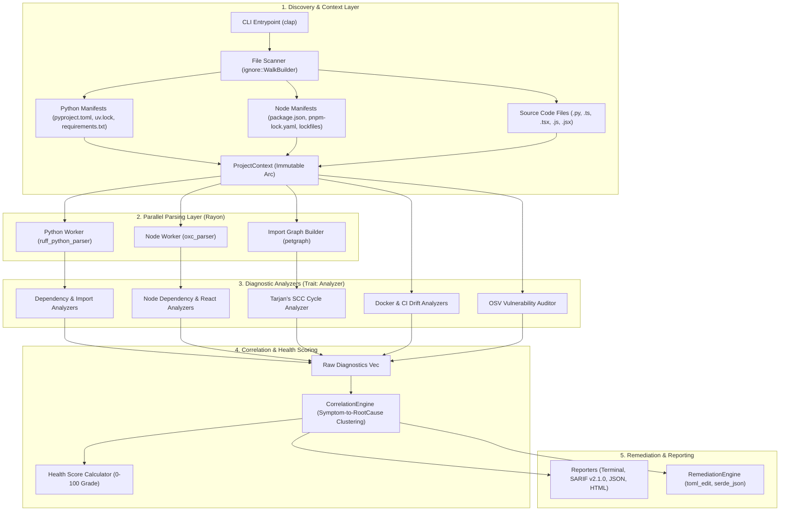

# StackVet (`stackvet`): Universal Project Health & Static Diagnostics Engine
## Complete Rust Architecture, Engineering Specification & Implementation Blueprint

---

## 1. Project Identity & Name Verification

### Selected Name: **`stackvet`**
* **Justification**:
  * **"Stack"**: Represents modern polyglot application stacks—Python backends (FastAPI, Django), Node/TypeScript frontends (React, Next.js), Docker environments, and CI workflows.
  * **"Vet"**: Means to rigorously examine, inspect, and evaluate for health, safety, and soundness (like a doctor/veteran auditor).
  * **CLI Usability**: 8 letters, memorable, easy to type: `stackvet check`, `stackvet doctor`, `stackvet fix`.
* **Live Registry Availability Check**:
  * **PyPI**: `404 Not Found` (Available: `pip install stackvet` / `uvx stackvet`)
  * **npm**: `404 Not Found` (Available: `npx stackvet`)
  * **Crates.io**: `404 Not Found` (Available: `cargo install stackvet`)

---

## 2. High-Level System Architecture



---

## 3. Cargo Workspace Structure

A modular Cargo workspace separating core abstractions from language-specific parsers:

```text
stackvet/
├── Cargo.toml                      # Workspace root
├── Cargo.lock
├── crates/
│   ├── stackvet-core/             # Shared types: Diagnostic, Rule, Severity, ProjectContext, RootCause
│   ├── stackvet-scanner/          # File discovery, git-ignore walker, project type detection
│   ├── stackvet-python/           # Python AST analysis (ruff_python_parser), manifest & lockfile parsers
│   ├── stackvet-node/             # JS/TS/JSX AST analysis (oxc_parser), package.json, pnpm/npm lockfiles
│   ├── stackvet-graph/            # Dependency & module import graph, cycle detection (petgraph)
│   ├── stackvet-analyzers/        # Core analyzers: deps, env, docker, ci, security
│   ├── stackvet-frameworks/       # Framework engines: FastAPI, React, Next.js, Django, SQLAlchemy
│   ├── stackvet-correlation/      # Root cause clustering, symptom grouping, health scoring
│   ├── stackvet-remediation/      # Format-preserving auto-fixes (toml_edit, json)
│   ├── stackvet-reporter/         # Terminal (crossterm/table), SARIF v2.1.0, JSON, HTML
│   └── stackvet-cli/              # CLI binary (clap)
├── npm/                           # npm distribution wrapper packages
└── pyproject.toml                 # Maturin configuration for PyPI wheel distribution
```

### 3.1 Workspace `Cargo.toml`
```toml
[workspace]
resolver = "2"
members = [
    "crates/stackvet-core",
    "crates/stackvet-scanner",
    "crates/stackvet-python",
    "crates/stackvet-node",
    "crates/stackvet-graph",
    "crates/stackvet-analyzers",
    "crates/stackvet-frameworks",
    "crates/stackvet-correlation",
    "crates/stackvet-remediation",
    "crates/stackvet-reporter",
    "crates/stackvet-cli",
]

[workspace.dependencies]
# CLI & Terminal
clap = { version = "4.5", features = ["derive", "env"] }
crossterm = "0.28"
comfy-table = "7.1"
colored = "2.1"
indicatif = "0.17"

# Concurrency & FS
rayon = "1.10"
ignore = "0.4"
walkdir = "2.5"
tokio = { version = "1.38", features = ["full"] }

# Parsers & AST
ruff_python_parser = "0.0.2"
ruff_python_ast = "0.0.2"
oxc_parser = "0.14"
oxc_ast = "0.14"
oxc_span = "0.14"
oxc_allocator = "0.14"

# Manifests & Data
serde = { version = "1.0", features = ["derive"] }
serde_json = "1.0"
serde_yaml = "0.9"
toml = "0.8"
toml_edit = { version = "0.22", features = ["serde"] }

# Graph & Algorithms
petgraph = "0.6"

# Networking & Security
reqwest = { version = "0.12", default-features = false, features = ["json", "rustls-tls"] }
url = "2.5"
semver = "1.0"

# Error Handling
thiserror = "1.0"
anyhow = "1.0"
tracing = "0.1"
tracing-subscriber = "0.3"
```

---

## 4. Core Domain Models (`stackvet-core`)

### 4.1 Diagnostic & Rule Representation
```rust
use std::path::PathBuf;
use serde::{Deserialize, Serialize};

#[derive(Debug, Clone, Copy, PartialEq, Eq, PartialOrd, Ord, Serialize, Deserialize)]
pub enum Severity {
    Hint,
    Info,
    Warning,
    Error,
    Critical,
}

#[derive(Debug, Clone, PartialEq, Eq, Hash, Serialize, Deserialize)]
pub struct RuleId(pub String);

impl RuleId {
    pub fn new(id: &str) -> Self {
        Self(id.to_string())
    }
}

#[derive(Debug, Clone, Copy, PartialEq, Eq, Serialize, Deserialize)]
pub enum LanguageTarget {
    Python,
    Node,
    Docker,
    Ci,
    General,
}

#[derive(Debug, Clone, Serialize, Deserialize)]
pub struct TextSpan {
    pub start_line: usize,
    pub start_col: usize,
    pub end_line: usize,
    pub end_col: usize,
}

#[derive(Debug, Clone, Serialize, Deserialize)]
pub struct DiagnosticLocation {
    pub file_path: PathBuf,
    pub span: Option<TextSpan>,
    pub snippet: Option<String>,
}

#[derive(Debug, Clone, Serialize, Deserialize)]
pub struct FixAction {
    pub description: String,
    pub file_path: PathBuf,
    pub replacement: String,
    pub span: Option<TextSpan>,
}

#[derive(Debug, Clone, Serialize, Deserialize)]
pub struct Diagnostic {
    pub rule_id: RuleId,
    pub message: String,
    pub severity: Severity,
    pub location: DiagnosticLocation,
    pub explanation: String,
    pub suggested_remediation: String,
    pub fix: Option<FixAction>,
    pub language: LanguageTarget,
}
```

### 4.2 Project Context (`ProjectContext`)
```rust
use std::collections::{HashMap, HashSet};
use std::path::PathBuf;
use std::sync::Arc;

#[derive(Debug, Clone)]
pub struct PythonProjectInfo {
    pub requires_python: Option<String>,
    pub package_manager: String, // uv, poetry, pip, pdm
    pub manifest_file: PathBuf,
    pub lock_file: Option<PathBuf>,
    pub direct_dependencies: HashMap<String, String>, // name -> version requirement
    pub dev_dependencies: HashMap<String, String>,
    pub installed_packages: HashMap<String, String>,   // if virtualenv detected
}

#[derive(Debug, Clone)]
pub struct NodeProjectInfo {
    pub node_version_constraint: Option<String>,
    pub package_manager: String, // npm, pnpm, yarn, bun
    pub package_json_path: PathBuf,
    pub lock_file: Option<PathBuf>,
    pub dependencies: HashMap<String, String>,
    pub dev_dependencies: HashMap<String, String>,
    pub peer_dependencies: HashMap<String, String>,
    pub tsconfig_paths: HashMap<String, Vec<String>>,
}

#[derive(Debug, Clone)]
pub struct ProjectContext {
    pub root: PathBuf,
    pub python: Option<PythonProjectInfo>,
    pub node: Option<NodeProjectInfo>,
    pub source_files: Vec<PathBuf>,
    pub dockerfiles: Vec<PathBuf>,
    pub ci_workflows: Vec<PathBuf>,
}
```

### 4.3 Root Cause Grouping (`RootCause`)
```rust
#[derive(Debug, Clone, Serialize, Deserialize)]
pub struct RootCause {
    pub id: String,
    pub title: String,
    pub summary: String,
    pub impact_severity: Severity,
    pub primary_remediation: String,
    pub automated_fix: Option<FixAction>,
    pub symptoms: Vec<Diagnostic>,
}
```

### 4.4 Analyzer Trait
```rust
use anyhow::Result;

pub trait Analyzer: Send + Sync {
    fn name(&self) -> &'static str;
    fn language(&self) -> LanguageTarget;
    fn analyze(&self, ctx: &ProjectContext) -> Result<Vec<Diagnostic>>;
}
```

---

## 5. File Scanner & Project Discovery Engine (`stackvet-scanner`)

### 5.1 Scanning Algorithm
Uses `ignore::WalkBuilder` for parallel, `.gitignore`-compliant discovery:
```rust
use ignore::WalkBuilder;
use std::path::{Path, PathBuf};

pub struct ProjectScanner {
    root: PathBuf,
}

impl ProjectScanner {
    pub fn new(root: impl AsRef<Path>) -> Self {
        Self { root: root.as_ref().to_path_buf() }
    }

    pub fn scan(&self) -> (Vec<PathBuf>, Vec<PathBuf>, Vec<PathBuf>) {
        let mut source_files = Vec::new();
        let mut manifest_files = Vec::new();
        let mut config_files = Vec::new();

        let walker = WalkBuilder::new(&self.root)
            .hidden(true)
            .parents(true)
            .git_ignore(true)
            .filter_entry(|entry| {
                let name = entry.file_name().to_string_lossy();
                name != "node_modules" 
                    && name != ".venv" 
                    && name != "venv" 
                    && name != "__pycache__" 
                    && name != "target" 
                    && name != ".git"
            })
            .build();

        for result in walker.flatten() {
            if result.file_type().map_or(false, |ft| ft.is_file()) {
                let path = result.into_path();
                let file_name = path.file_name().map(|s| s.to_string_lossy().to_string()).unwrap_or_default();
                
                if file_name == "pyproject.toml" || file_name == "package.json" || file_name == "requirements.txt" {
                    manifest_files.push(path);
                } else if let Some(ext) = path.extension().and_then(|s| s.to_str()) {
                    match ext {
                        "py" | "ts" | "tsx" | "js" | "jsx" => source_files.push(path),
                        "yml" | "yaml" | "toml" | "json" => config_files.push(path),
                        _ => {}
                    }
                }
            }
        }
        (source_files, manifest_files, config_files)
    }
}
```

---

## 6. Parsing & AST Traversal Engines

### 6.1 Python AST Parser (`stackvet-python`)
Using `ruff_python_parser` to extract all imports without executing Python:
```rust
use ruff_python_parser::parse_module;
use ruff_python_ast::{Mod, Stmt, StmtImport, StmtImportFrom};
use std::path::Path;

#[derive(Debug, Clone)]
pub struct PythonImport {
    pub module: String,
    pub symbol: Option<String>,
    pub line: usize,
    pub is_relative: bool,
}

pub fn parse_python_imports(content: &str, file: &Path) -> Vec<PythonImport> {
    let mut imports = Vec::new();
    if let Ok(parsed) = parse_module(content) {
        if let Mod::Module(module) = parsed.into_syntax() {
            for stmt in module.body {
                match stmt {
                    Stmt::Import(StmtImport { names, range }) => {
                        for alias in names {
                            imports.push(PythonImport {
                                module: alias.name.to_string(),
                                symbol: None,
                                line: 1, // calculated from range
                                is_relative: false,
                            });
                        }
                    }
                    Stmt::ImportFrom(StmtImportFrom { module, names, level, range }) => {
                        let mod_name = module.map(|m| m.to_string()).unwrap_or_default();
                        for alias in names {
                            imports.push(PythonImport {
                                module: mod_name.clone(),
                                symbol: Some(alias.name.to_string()),
                                line: 1,
                                is_relative: level > 0,
                            });
                        }
                    }
                    _ => {}
                }
            }
        }
    }
    imports
}
```

### 6.2 Node & React AST Parser (`stackvet-node`)
Using `oxc_parser` and `oxc_allocator::Allocator` for ultra-fast JS/TS/JSX parsing:
```rust
use oxc_allocator::Allocator;
use oxc_parser::Parser;
use oxc_span::SourceType;
use oxc_ast::ast::{Declaration, ModuleDeclaration, Statement};
use std::path::Path;

#[derive(Debug, Clone)]
pub struct NodeImport {
    pub specifier: String,
    pub is_dynamic: bool,
    pub is_type_only: bool,
    pub line: usize,
}

pub fn parse_node_imports(content: &str, file: &Path) -> Vec<NodeImport> {
    let allocator = Allocator::default();
    let source_type = SourceType::from_path(file).unwrap_or_default();
    let ret = Parser::new(&allocator, content, source_type).parse();
    
    let mut imports = Vec::new();
    for stmt in &ret.program.body {
        if let Statement::Declaration(Declaration::ImportDeclaration(import_decl)) = stmt {
            imports.push(NodeImport {
                specifier: import_decl.source.value.to_string(),
                is_dynamic: false,
                is_type_only: import_decl.import_kind.is_type(),
                line: 1,
            });
        }
    }
    imports
}
```

---

## 7. Import Graph & Circular Dependency Detection (`stackvet-graph`)

### 7.1 Tarjan’s Strongly Connected Components Algorithm
Uses `petgraph::algo::tarjan_scc` to find all cycles across Python modules and TypeScript files:
```rust
use petgraph::graphmap::DiGraphMap;
use petgraph::algo::tarjan_scc;

pub struct ImportGraph<'a> {
    graph: DiGraphMap<&'a str, ()>,
}

impl<'a> ImportGraph<'a> {
    pub fn new() -> Self {
        Self { graph: DiGraphMap::new() }
    }

    pub fn add_import(&mut self, from_module: &'a str, to_module: &'a str) {
        self.graph.add_edge(from_module, to_module, ());
    }

    pub fn find_cycles(&self) -> Vec<Vec<&'a str>> {
        let sccs = tarjan_scc(&self.graph);
        sccs.into_iter()
            .filter(|component| component.len() > 1 || self.graph.contains_edge(component[0], component[0]))
            .collect()
    }
}
```

---

## 8. Complete Diagnostic Rules Catalog & Implementation Specs

### 8.1 Python Dependency Rules (`DEP-xxx`)
* **`DEP-001` (Version Conflict)**: Parses requirement specs; checks if `foo>=2.0` and `foo<2.0` coexist in dependency tree.
* **`DEP-002` (Missing Declaration)**: If `import requests` is parsed from `.py`, check if `requests` is in `pyproject.toml` or `requirements.txt`. If not and not stdlib $\rightarrow$ `ERROR`.
* **`DEP-003` (Unused Dependency)**: If `celery` is listed in `pyproject.toml`, but zero Python files import `celery` $\rightarrow$ `WARNING`.
* **`DEP-004` (Python Version Incompatible)**: If `pyproject.toml` specifies `requires-python = ">=3.11"`, but dependency requires `python < 3.10` $\rightarrow$ `ERROR`.
* **`DEP-005` (Lockfile Drift)**: Hashes `dependencies` table in `pyproject.toml` and compares against the lockfile metadata hash in `uv.lock`/`poetry.lock`.
* **`DEP-006` (Vulnerability Audit)**: Batches package names and versions against OSV API (`https://api.osv.dev/v1/querybatch`) for known CVEs.
* **`DEP-007` (Transitive Dependency Import)**: If package is found in `uv.lock` or `site-packages` but missing from direct `pyproject.toml` dependencies $\rightarrow$ `WARNING`.

### 8.2 Node Dependency Rules (`NDEP-xxx`)
* **`NDEP-001` (Missing Node Package)**: If `import axios from 'axios'` exists in `.ts`/`.tsx`, but `axios` is not in `dependencies` or `devDependencies` of `package.json` $\rightarrow$ `ERROR`.
* **`NDEP-002` (Unused Node Package)**: If `lodash` is in `package.json`, but no import references `lodash` or `lodash/*` $\rightarrow$ `WARNING`.
* **`NDEP-003` (Unmet Peer Dependency)**: If a package specifies `"peerDependencies": { "react": "^18.0.0" }`, but project has `react: "^19.0.0"` $\rightarrow$ `ERROR`.
* **`NDEP-004` (Lockfile Out of Sync)**: Missing `package-lock.json` or `pnpm-lock.yaml` timestamp older than `package.json` modifications $\rightarrow$ `WARNING`.
* **`NDEP-005` (DevDependency in Production)**: Importing packages listed under `devDependencies` (like `vitest`, `jest`, `@types/*`) inside `src/` (outside `*.test.ts`, `*.spec.tsx`) $\rightarrow$ `ERROR`.

### 8.3 Import & Architecture Rules (`IMP-xxx`, `ARC-xxx`)
* **`IMP-001` (Circular Imports)**: Triggers when `ImportGraph::find_cycles()` returns SCCs $>1$. Output lists exact cycle path: `a.ts -> b.ts -> c.ts -> a.ts`.
* **`IMP-002` (Unresolved Local Import)**: Relative import `from .utils import helper` or `import { x } from './utils'` has no corresponding physical file on disk.
* **`IMP-003` (Orphan File / Dead Code)**: A source file with 0 incoming imports that is not an entrypoint (`main.py`, `index.ts`, `App.tsx`, route file) $\rightarrow$ `WARNING`.
* **`IMP-004` (PEP 594 Removed Stdlib)**: Importing deprecated standard library modules removed in Python 3.13 (`cgi`, `pipes`, `imp`, `chunk`, `crypt`, `telnetlib`).
* **`ARC-001` (Layer Violation)**: Modules in `database/` importing from `api/`, or `ui/` importing private database internals directly.
* **`ARC-002` (Component Cycle)**: Top-level feature directory cycles (e.g. `src/features/auth` $\leftrightarrow$ `src/features/billing`).

### 8.4 Environment & Drift Rules (`ENV-xxx`)
* **`ENV-001` (Runtime Drift)**: Local interpreter or `.nvmrc`/`.python-version` contradicts manifest declaration.
* **`ENV-002` (Docker Drift)**: `FROM python:3.10-slim` in `Dockerfile` while `pyproject.toml` requires `python >= 3.12`.
* **`ENV-003` (CI Matrix Drift)**: `.github/workflows/ci.yml` testing `python-version: ["3.10"]` while project target is `3.12`.

### 8.5 Framework Analyzers

#### FastAPI Rules (`FAP-001` to `FAP-026`)
* **`FAP-001`**: Traversing AST of `async def` routes: flagging calls to `time.sleep()`, `requests.*`, `subprocess.*`, or synchronous database query methods.
* **`FAP-003`**: Route handler without `response_model` argument or return type annotation (`-> Model`).
* **`FAP-004`**: CORS middleware with `allow_origins=["*"]` + `allow_credentials=True`.
* **`FAP-006`**: Path template placeholder (e.g., `"/items/{item_id}"`) where `item_id` is missing in function parameters.
* **`FAP-008`**: Decorator `@app.on_event("startup")` used instead of `lifespan` context manager.
* **`FAP-010`**: Multiple routes registered on identical method and path.
* **`FAP-011`**: Mutable default parameter: `def get_items(q: list = []):`.
* **`FAP-015`**: Synchronous file I/O (`open()`, `with open(...)`) inside `async def` route.

#### React & Next.js Rules (`RCT-001` to `RCT-006`, `NXT-001` to `NXT-002`)
* **`RCT-001` (Missing Hook Dependencies)**: AST inspection of `useEffect` / `useCallback` dependency array comparing free variables used inside closure.
* **`RCT-002` (Conditional Hook)**: Invoking `use*` functions inside `IfStatement`, `ForStatement`, `WhileStatement`, or nested functions.
* **`RCT-003` (Direct State Mutation)**: Direct assignments `state.foo = 1` or `state.push(x)`.
* **`RCT-004` (Missing Key)**: `.map()` return containing JSX elements without a `key` prop.
* **`RCT-005` (Barrel Import Bloat)**: Importing from massive barrel files (e.g. `import { Button } from '@mui/material'`) in large apps without modularized path imports.
* **`NXT-001` (Server Component Client API)**: Using `useState`, `useEffect`, `window`, or `localStorage` in a Next.js file without `"use client"` directive at top.
* **`NXT-002` (Leaked Client Env)**: Client components referencing `process.env.SECRET` instead of `process.env.NEXT_PUBLIC_*`.

---

## 9. Correlation Engine & Doctor Health Scoring (`stackvet-correlation`)

### 9.1 Grouping Logic
Correlates related symptoms by matching:
1. Shared missing dependency name across multiple unresolved import diagnostics.
2. Circular dependency chain grouping individual file diagnostics into a single cycle root cause.
3. Lockfile drift grouping individual package version mismatch warnings.

### 9.2 Doctor Health Score Formula
A deterministic 0–100 integer score:
```rust
pub fn calculate_health_score(diagnostics: &[Diagnostic]) -> u32 {
    let mut score: i32 = 100;
    for d in diagnostics {
        match d.severity {
            Severity::Critical => score -= 20,
            Severity::Error => score -= 8,
            Severity::Warning => score -= 2,
            Severity::Info | Severity::Hint => {},
        }
    }
    score.clamp(0, 100) as u32
}

pub fn score_grade(score: u32) -> &'static str {
    match score {
        90..=100 => "A (Healthy)",
        75..=89 => "B (Fair)",
        50..=74 => "C (Degraded)",
        _ => "F (Critical Issues)",
    }
}
```

---

## 10. Automated Remediation Engine (`stackvet-remediation`)

### 10.1 Formatting-Preserving Manifest Edits
Using `toml_edit` to inject dependencies into `pyproject.toml` without wiping out user comments or formatting:
```rust
use toml_edit::{DocumentMut, Array, Item, Value};
use anyhow::Result;

pub fn add_dependency_to_pyproject(content: &str, package: &str, version: &str) -> Result<String> {
    let mut doc: DocumentMut = content.parse()?;
    let spec = format!("{}>={}", package, version);
    
    if let Some(project) = doc.get_mut("project").and_then(Item::as_table_mut) {
        if let Some(deps) = project.get_mut("dependencies").and_then(Item::as_array_mut) {
            deps.push(spec);
        } else {
            let mut arr = Array::new();
            arr.push(spec);
            project.insert("dependencies", Item::Value(Value::Array(arr)));
        }
    }
    Ok(doc.to_string())
}
```

---

## 11. CLI Commands & Reporters (`stackvet-cli`, `stackvet-reporter`)

### 11.1 CLI Commands (`clap`)
```text
stackvet doctor            Run full health check, calculate grade, and list root causes
stackvet check [path]      Fast CI gate: returns exit code 0 (clean) or 1 (errors)
stackvet inspect [path]    Deep inspection with code snippets and remediation guidance
stackvet fix [path]        Interactively or automatically apply safe fixes
stackvet graph [path]      Visualize dependency and import graph (ASCII, Mermaid, DOT)
stackvet rules             Browse full catalog of supported diagnostic rules
```

### 11.2 Output Formats
* **`--format text`**: Rich terminal tables with ANSI colors and progress indicators.
* **`--format json`**: Full machine-readable diagnostic schema.
* **`--format sarif`**: Emits OASIS SARIF v2.1.0 for direct GitHub Code Scanning integration.
* **`--format html`**: Standalone HTML report with responsive dark-mode UI.

---

## 12. Distribution Strategy: PyPI, npm, and Native Binaries

### 12.1 Triple-Distribution Architecture
1. **PyPI (`pip install stackvet` / `uvx stackvet`)**:
   * Uses **Maturin** to build standalone platform wheels containing the compiled Rust binary.
2. **npm (`npx stackvet` / `pnpm add -D stackvet`)**:
   * Standard npm wrapper package with `@stackvet/cli` delegating to optional platform binaries (`@stackvet/darwin-arm64`, `@stackvet/linux-x64`, `@stackvet/windows-x64`).
3. **Crates.io (`cargo install stackvet`)**:
   * Pure native Rust build.
4. **GitHub Releases & Homebrew**:
   * Prebuilt static binaries via `cargo-dist` or GitHub Actions release matrix.

---

## 13. Phased Implementation Roadmap

| Milestone | Deliverables | Target Timeline |
|---|---|---|
| **Phase 1: Workspace & Discovery** | Cargo workspace setup, `stackvet-core`, `stackvet-scanner`, basic `pyproject.toml` and `package.json` parsers. | Days 1–5 |
| **Phase 2: Dependency Rules & CLI** | `DEP-001` to `DEP-005`, `NDEP-001` to `NDEP-003`, `clap` CLI, terminal scorecard. | Days 6–10 |
| **Phase 3: AST & Import Engines** | `ruff_python_parser` integration, `oxc_parser` integration, `petgraph` cycle detection (`IMP-001`). | Days 11–17 |
| **Phase 4: Framework Analyzers** | FastAPI 26+ rules port, React & Next.js rules, Docker & CI drift rules. | Days 18–25 |
| **Phase 5: Scoring, Fixes, & Egress** | Correlation engine, health score, `toml_edit` fixes, SARIF & HTML reports. | Days 26–30 |
| **Phase 6: Multi-Registry Publishing** | Maturin PyPI wheels, npm binary packages, Crates.io release. | Days 31–35 |

---

## 14. Turnkey Bootstrap Pack & Sub-Crate Manifests

### 14.1 Sub-Crate `Cargo.toml` Files

#### `crates/stackvet-core/Cargo.toml`
```toml
[package]
name = "stackvet-core"
version = "0.1.0"
edition = "2021"

[dependencies]
serde = { workspace = true }
serde_json = { workspace = true }
thiserror = { workspace = true }
anyhow = { workspace = true }
```

#### `crates/stackvet-scanner/Cargo.toml`
```toml
[package]
name = "stackvet-scanner"
version = "0.1.0"
edition = "2021"

[dependencies]
stackvet-core = { path = "../stackvet-core" }
ignore = { workspace = true }
walkdir = { workspace = true }
anyhow = { workspace = true }
tracing = { workspace = true }
```

#### `crates/stackvet-python/Cargo.toml`
```toml
[package]
name = "stackvet-python"
version = "0.1.0"
edition = "2021"

[dependencies]
stackvet-core = { path = "../stackvet-core" }
ruff_python_parser = { workspace = true }
ruff_python_ast = { workspace = true }
toml = { workspace = true }
serde = { workspace = true }
anyhow = { workspace = true }
```

#### `crates/stackvet-node/Cargo.toml`
```toml
[package]
name = "stackvet-node"
version = "0.1.0"
edition = "2021"

[dependencies]
stackvet-core = { path = "../stackvet-core" }
oxc_parser = { workspace = true }
oxc_ast = { workspace = true }
oxc_allocator = { workspace = true }
oxc_span = { workspace = true }
serde_json = { workspace = true }
anyhow = { workspace = true }
```

#### `crates/stackvet-graph/Cargo.toml`
```toml
[package]
name = "stackvet-graph"
version = "0.1.0"
edition = "2021"

[dependencies]
stackvet-core = { path = "../stackvet-core" }
petgraph = { workspace = true }
anyhow = { workspace = true }
```

#### `crates/stackvet-analyzers/Cargo.toml`
```toml
[package]
name = "stackvet-analyzers"
version = "0.1.0"
edition = "2021"

[dependencies]
stackvet-core = { path = "../stackvet-core" }
stackvet-python = { path = "../stackvet-python" }
stackvet-node = { path = "../stackvet-node" }
stackvet-graph = { path = "../stackvet-graph" }
rayon = { workspace = true }
semver = { workspace = true }
serde_yaml = { workspace = true }
reqwest = { workspace = true }
tokio = { workspace = true }
anyhow = { workspace = true }
tracing = { workspace = true }
```

#### `crates/stackvet-frameworks/Cargo.toml`
```toml
[package]
name = "stackvet-frameworks"
version = "0.1.0"
edition = "2021"

[dependencies]
stackvet-core = { path = "../stackvet-core" }
stackvet-python = { path = "../stackvet-python" }
stackvet-node = { path = "../stackvet-node" }
ruff_python_ast = { workspace = true }
oxc_ast = { workspace = true }
anyhow = { workspace = true }
```

#### `crates/stackvet-correlation/Cargo.toml`
```toml
[package]
name = "stackvet-correlation"
version = "0.1.0"
edition = "2021"

[dependencies]
stackvet-core = { path = "../stackvet-core" }
anyhow = { workspace = true }
```

#### `crates/stackvet-remediation/Cargo.toml`
```toml
[package]
name = "stackvet-remediation"
version = "0.1.0"
edition = "2021"

[dependencies]
stackvet-core = { path = "../stackvet-core" }
toml_edit = { workspace = true }
serde_json = { workspace = true }
anyhow = { workspace = true }
```

#### `crates/stackvet-reporter/Cargo.toml`
```toml
[package]
name = "stackvet-reporter"
version = "0.1.0"
edition = "2021"

[dependencies]
stackvet-core = { path = "../stackvet-core" }
crossterm = { workspace = true }
comfy-table = { workspace = true }
colored = { workspace = true }
serde_json = { workspace = true }
anyhow = { workspace = true }
```

#### `crates/stackvet-cli/Cargo.toml`
```toml
[package]
name = "stackvet"
version = "0.1.0"
edition = "2021"

[dependencies]
stackvet-core = { path = "../stackvet-core" }
stackvet-scanner = { path = "../stackvet-scanner" }
stackvet-analyzers = { path = "../stackvet-analyzers" }
stackvet-frameworks = { path = "../stackvet-frameworks" }
stackvet-correlation = { path = "../stackvet-correlation" }
stackvet-remediation = { path = "../stackvet-remediation" }
stackvet-reporter = { path = "../stackvet-reporter" }
clap = { workspace = true }
tracing = { workspace = true }
tracing-subscriber = { workspace = true }
anyhow = { workspace = true }
tokio = { workspace = true }
```

---

### 14.2 Built-in Standard Library Whitelists

To accurately identify missing third-party packages without false positives, embed these static sets in `stackvet-python` and `stackvet-node`:

#### Python Standard Library Modules (`stackvet-python/src/stdlib.rs`)
```rust
pub static PYTHON_STDLIB: &[&str] = &[
    "abc", "argparse", "array", "ast", "asyncio", "base64", "binascii", "bisect",
    "builtins", "bz2", "calendar", "cmath", "cmd", "code", "codecs", "collections",
    "colorsys", "compileall", "concurrent", "configparser", "contextlib", "contextvars",
    "copy", "copyreg", "cProfile", "csv", "ctypes", "curses", "dataclasses", "datetime",
    "dbm", "decimal", "difflib", "dis", "doctest", "email", "encodings", "ensurepip",
    "enum", "errno", "faulthandler", "fcntl", "filecmp", "fileinput", "fnmatch",
    "fractions", "ftplib", "functools", "gc", "getopt", "getpass", "gettext", "glob",
    "graphlib", "gzip", "hashlib", "heapq", "hmac", "html", "http", "idlelib", "imaplib",
    "importlib", "inspect", "io", "ipaddress", "itertools", "json", "keyword", "linecache",
    "locale", "logging", "lzma", "mailbox", "math", "mimetypes", "mmap", "modulefinder",
    "multiprocessing", "netrc", "numbers", "operator", "os", "pathlib", "pdb", "pickle",
    "pkgutil", "platform", "plistlib", "poplib", "posix", "pprint", "profile", "pstats",
    "pty", "pwd", "py_compile", "pyclbr", "pydoc", "queue", "quopri", "random", "re",
    "readline", "reprlib", "resource", "rlcompleter", "runpy", "sched", "secrets",
    "select", "selectors", "shelve", "shlex", "shutil", "signal", "site", "smtplib",
    "socket", "socketserver", "sqlite3", "ssl", "stat", "statistics", "string", "stringprep",
    "struct", "subprocess", "sys", "sysconfig", "syslog", "tabnanny", "tarfile", "tempfile",
    "termios", "test", "textwrap", "threading", "time", "timeit", "tkinter", "token",
    "tokenize", "tomllib", "trace", "traceback", "tracemalloc", "tty", "turtle", "types",
    "typing", "unicodedata", "unittest", "urllib", "uuid", "venv", "warnings", "wave",
    "weakref", "webbrowser", "winreg", "winsound", "wsgiref", "xml", "xmlrpc", "zipapp",
    "zipfile", "zipimport", "zlib", "zoneinfo"
];

// PEP 594: Modules removed in Python 3.13
pub static PYTHON_REMOVED_PEP594: &[&str] = &[
    "aifc", "audioop", "cgi", "cgitb", "chunk", "crypt", "imghdr", "mailcap",
    "msilib", "nis", "nntplib", "ossaudiodev", "pipes", "sndhdr", "spwd",
    "sunau", "telnetlib", "uu", "xdrlib"
];
```

#### Node.js Built-in Modules (`stackvet-node/src/builtins.rs`)
```rust
pub static NODE_BUILTINS: &[&str] = &[
    "assert", "async_hooks", "buffer", "child_process", "cluster", "console",
    "constants", "crypto", "dgram", "diagnostics_channel", "dns", "domain",
    "events", "fs", "fs/promises", "http", "http2", "https", "inspector",
    "module", "net", "os", "path", "path/posix", "path/win32", "perf_hooks",
    "process", "punycode", "querystring", "readline", "repl", "stream",
    "stream/promises", "stream/consumers", "stream/web", "string_decoder",
    "timers", "timers/promises", "tls", "trace_events", "tty", "url", "util",
    "util/types", "v8", "vm", "wasi", "worker_threads", "zlib"
];
```

---

### 14.3 Complete CLI Structs (`crates/stackvet-cli/src/main.rs`)

```rust
use clap::{Parser, Subcommand, ValueEnum};
use std::path::PathBuf;

#[derive(Parser, Debug)]
#[command(
    name = "stackvet",
    about = "Universal project health and static diagnostics engine",
    version,
    author
)]
pub struct Cli {
    #[arg(short, long, default_value = ".", help = "Target project directory")]
    pub path: PathBuf,

    #[arg(short, long, value_enum, default_value_t = OutputFormat::Text, help = "Output report format")]
    pub format: OutputFormat,

    #[arg(long, help = "Run offline without querying vulnerability databases")]
    pub offline: bool,

    #[command(subcommand)]
    pub command: Option<Commands>,
}

#[derive(Subcommand, Debug)]
pub enum Commands {
    #[command(about = "Unified health scorecard, grade (A-F), and top root causes")]
    Doctor {
        #[arg(long, help = "Fail with exit code 1 if health score is below threshold")]
        min_score: Option<u32>,
    },
    #[command(about = "Fast CI gate (returns 0 for clean, 1 for errors)")]
    Check {
        #[arg(long, help = "Treat warnings as errors")]
        strict: bool,
    },
    #[command(about = "Detailed inspection with code snippets and remediation guidance")]
    Inspect {
        #[arg(long, help = "Filter by rule ID prefix (e.g. FAP, DEP, RCT)")]
        rule: Option<String>,
    },
    #[command(about = "Apply automated safe remediations")]
    Fix {
        #[arg(long, help = "Automatically apply all safe fixes without confirmation")]
        yes: bool,
    },
    #[command(about = "Visualize dependency or module import graph")]
    Graph {
        #[arg(long, value_enum, default_value_t = GraphFormat::Ascii)]
        style: GraphFormat,
    },
    #[command(about = "List and search all supported diagnostic rules")]
    Rules,
}

#[derive(ValueEnum, Clone, Copy, Debug, PartialEq, Eq)]
pub enum OutputFormat {
    Text,
    Json,
    Sarif,
    Html,
}

#[derive(ValueEnum, Clone, Copy, Debug, PartialEq, Eq)]
pub enum GraphFormat {
    Ascii,
    Mermaid,
    Dot,
}

#[tokio::main]
async fn main() -> anyhow::Result<()> {
    let cli = Cli::parse();
    // Dispatch to scan -> analyze -> correlate -> report
    Ok(())
}
```

---

### 14.4 One-Command Automated Bootstrap Script

To initialize a brand new folder into a fully compiling `stackvet` repository in 5 seconds, use either script:

#### Linux / macOS: `bootstrap.sh`
```bash
#!/usr/bin/env bash
set -euo pipefail

mkdir -p crates/{stackvet-core,stackvet-scanner,stackvet-python,stackvet-node,stackvet-graph,stackvet-analyzers,stackvet-frameworks,stackvet-correlation,stackvet-remediation,stackvet-reporter,stackvet-cli}/src

# Create lib.rs in all library crates
for crate in stackvet-core stackvet-scanner stackvet-python stackvet-node stackvet-graph stackvet-analyzers stackvet-frameworks stackvet-correlation stackvet-remediation stackvet-reporter; do
    echo "//! $crate" > "crates/$crate/src/lib.rs"
done

# Create main.rs in CLI
echo 'fn main() { println!("stackvet initialized!"); }' > crates/stackvet-cli/src/main.rs

cargo check
echo "Successfully bootstrapped stackvet workspace!"
```

#### Windows PowerShell: `bootstrap.ps1`
```powershell
$crates = @(
    "stackvet-core", "stackvet-scanner", "stackvet-python", "stackvet-node",
    "stackvet-graph", "stackvet-analyzers", "stackvet-frameworks",
    "stackvet-correlation", "stackvet-remediation", "stackvet-reporter"
)

foreach ($c in $crates) {
    New-Item -ItemType Directory -Force -Path "crates/$c/src" | Out-Null
    Set-Content -Path "crates/$c/src/lib.rs" -Value "//! $c"
}

New-Item -ItemType Directory -Force -Path "crates/stackvet-cli/src" | Out-Null
Set-Content -Path "crates/stackvet-cli/src/main.rs" -Value 'fn main() { println!("stackvet initialized!"); }'

cargo check
Write-Host "Successfully bootstrapped stackvet workspace!" -ForegroundColor Green
```

