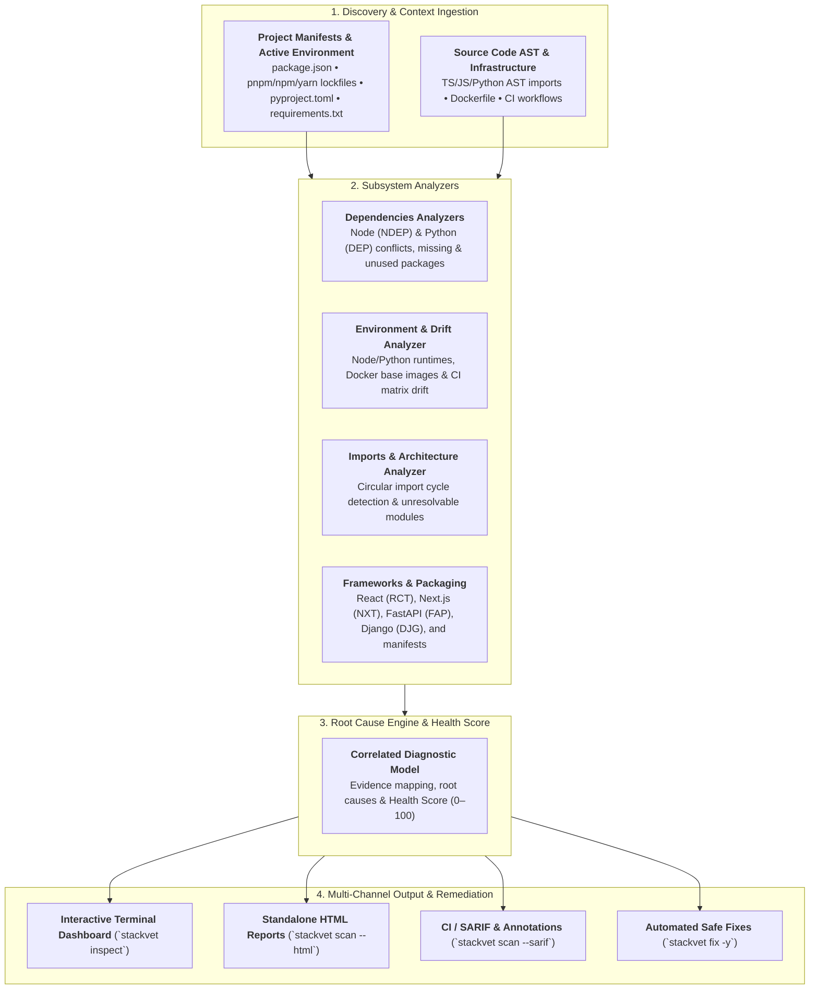

<p align="center">
  <a href="https://inzamol.github.io/stackvet/">
    
  </a>
</p>

<h1 align="center">StackVet</h1>

<p align="center">
  <strong>Universal Project Health & Static Diagnostics Engine</strong><br />
  <em>Analyze Node.js, TypeScript, and Python projects for broken dependencies, runtime drift, framework pitfalls, and architectural problems in milliseconds.</em>
</p>

<p align="center">
  <a href="https://www.npmjs.com/package/@inzamol/stackvet"></a>
  <a href="https://pypi.org/project/stackvet/"></a>
  <a href="https://crates.io/crates/stackvet"></a>
  <a href="https://marketplace.visualstudio.com/items?itemName=inzamrzn918.stackvet-vscode"></a>
  <a href="https://github.com/inzamol/stackvet/actions/workflows/test.yml"></a>
  <a href="https://inzamol.github.io/stackvet/"></a>
  <a href="https://github.com/inzamol/stackvet/blob/main/LICENSE"></a>
</p>

<p align="center">
  
  
  
  
  
  
  
  
</p>

---

`stackvet` is a high-performance, polyglot diagnostic and project health engine for modern stacks (Node.js/TypeScript, Python, Docker, and CI/CD). It inspects your project manifests (`package.json`, `pnpm-lock.yaml`, `package-lock.json`, `yarn.lock`, `pyproject.toml`, `requirements.txt`, `uv.lock`), active runtime environments, source code ASTs, and infrastructure definitions in milliseconds to uncover broken dependencies, undeclared packages, circular import loops, and runtime drift.

---

## 1. Overview & Architecture

Unlike generic tools that only inspect a single lockfile or flat requirements list, `stackvet` correlates multi-layer diagnostic signals across your entire project ecosystem:



👉 *Learn more in the comprehensive [Architecture & Internal Design](architecture.md) documentation.*

---

## 2. Install & Usage

Run `stackvet doctor` or `stackvet scan` directly in any Node.js, TypeScript, Python, or polyglot repository root:

=== "Run without installing (npx)"
    ```bash
    npx @inzamol/stackvet doctor
    ```

=== "Using npm (Node.js)"
    ```bash
    npm install --save-dev @inzamol/stackvet
    npx stackvet doctor
    ```

=== "Using pnpm / yarn"
    ```bash
    # pnpm
    pnpm add -D @inzamol/stackvet
    pnpm exec stackvet doctor

    # yarn
    yarn add -D @inzamol/stackvet
    yarn stackvet doctor
    ```

=== "Run without installing (uvx / pipx)"
    ```bash
    uvx stackvet doctor
    # or
    pipx run stackvet doctor
    ```

=== "Using uv (Python)"
    ```bash
    uv add stackvet --dev
    uv run stackvet doctor
    ```

=== "Using pip (Python)"
    ```bash
    pip install stackvet
    stackvet doctor
    ```

=== "Via Cargo (Rust)"
    ```bash
    cargo install stackvet
    stackvet doctor
    ```

=== "From GitHub (Latest)"
    ```bash
    pip install git+https://github.com/inzamol/stackvet.git
    stackvet doctor
    ```

=== "From Local Codebase"
    ```bash
    git clone https://github.com/inzamol/stackvet.git
    cd stackvet
    pip install -e .
    # or with uv
    uv pip install -e .
    ```

### 2.1 Live Diagnostic Output

```text
=======================================================================
                StackVet Universal Project Health Report               
=======================================================================

  Health Score: 92 / 100
  Overall Grade: A (Healthy)
  Calculation:   Base 100 - 8 deductions (1 unique finding, 0 duplicates ignored)

  Critical: 0  |  Errors: 1  |  Warnings: 0

--- Health Score Deduction Breakdown ---
  • [ERROR] DEP-001: -8 pts (1 finding) - Dependency constraint conflict

--- Root Cause Clusters (1) ---
1. [ERROR] Rule Violation: DEP-001
   Summary: celery 5.4.0 requires kombu<5.4.0,>=5.3.0, but installed is kombu 5.5.2.
   Remediation: Upgrade celery or pin kombu to <5.4.0,>=5.3.0.
   Symptoms Count: 1

--- Diagnostic Details ---
╭─────────┬──────────┬──────────────┬──────────────────┬────────────────────────────────────────────────────────────────────────╮
│ Rule    ┆ Severity ┆ Target       ┆ File Location    ┆ Message                                                                │
╞═════════╪══════════╪══════════════╪══════════════════╪════════════════════════════════════════════════════════════════════════╡
│ DEP-001 ┆ ERROR    ┆ Dependencies ┆ requirements.txt ┆ celery 5.4.0 requires kombu<5.4.0,>=5.3.0, but installed is kombu 5.5.2 │
╰─────────┴──────────┴──────────────┴──────────────────┴────────────────────────────────────────────────────────────────────────╯
```

---

## 3. Core Feature Pillars

<div class="grid cards" markdown>

-   __Interactive Terminal Dashboard__

    ---

    Explore findings interactively with keyboard navigation (`↑`/`↓`), expand evidence, view live dependency trees (`t`), and apply fixes (`f`) in a rich TUI.

    [:material-arrow-right: Open CLI Reference](cli_reference.md)

-   __Self-Contained HTML Reports__

    ---

    Generate portable, zero-dependency HTML reports (`stackvet scan --html`) with circular health score gauges, real-time search, severity filters, and dark mode.

    [:material-arrow-right: Open HTML Report Guide](html_report.md)

-   __Safe Automated Fixes__

    ---

    Compute deterministic remediation plans with `stackvet fix --dry-run` and safely synchronize manifests and package managers with `stackvet fix --sync -y`.

    [:material-arrow-right: Open Remediation Guide](remediation.md)

-   __Dependency & Import Trees__

    ---

    Visualize direct vs transitive package trees (`stackvet graph -d`) and internal module import architecture with circular loops highlighted (`stackvet graph -i`).

    [:material-arrow-right: Open Tree Visualizer Guide](tree.md)

</div>

---

## 4. Diagnostic Subsystems

| Subsystem | Scope & Capabilities | Key Rules |
|---|---|---|
| **Node Dependencies** | Undeclared package imports in TS/JS, unused production dependencies, peer conflicts, lockfile drift (`pnpm-lock.yaml`, `package-lock.json`, `yarn.lock`, `bun.lockb`) | `NDEP-001` through `NDEP-005` |
| **React & Next.js** | Hook dependencies, conditional hook calls, direct state mutation, missing keys in lists, barrel import bloat, Server/Client component leaks, private environment variable exposure | `RCT-001`–`RCT-005`, `NXT-001`–`NXT-002` |
| **Python Dependencies** | Constraint conflicts, undeclared imports, unused packages, Python runtime compatibility mismatches, lockfile drift (`uv.lock`, `poetry.lock`) | `DEP-001` through `DEP-007` |
| **FastAPI & Python Frameworks** | Blocking calls in async routes, missing response models, wildcard CORS, path parameter discrepancies, SQLAlchemy N+1 queries, Django settings, Celery risks | `FAP-xxx`, `SQL-xxx`, `DJG-xxx`, `CEL-xxx` |
| **Environment & Drift** | Node (`.nvmrc`, `package.json` engines) and Python (`.python-version`, `pyproject.toml`) runtime drift against Dockerfile base images and CI test matrices | `ENV-001` through `ENV-003` |
| **Architecture & Imports** | Circular import cycle detection, unresolvable module imports, dead orphan files, deprecated stdlib, architectural tier violations | `IMP-001`–`IMP-004`, `ARC-001`–`ARC-002` |
| **Docker & Containers** | Security best practices, root user risks, unpinned base images, sensitive file leaks, caching optimizations | `DOC-001` through `DOC-014` |
| **CI Workflows** | Matrix mismatches, unpinned dependencies, outdated GitHub Actions, quality gates, hardcoded secrets | `CI-001` through `CI-006` |

👉 *Browse full rule descriptions and remediation strategies in the [Rules Catalog](rules.md).*

---

## 5. Unified Polyglot Advantage

`stackvet` replaces multiple fragmented, single-ecosystem linters with a single, ultra-fast native engine producing unified health scoring across your entire stack:

| Capability | `stackvet` | `depcheck` / `knip` (Node) | `pip check` / `deptry` (Python) | `npm audit` / `pip-audit` |
|---|:---:|:---:|:---:|:---:|
| **Polyglot Monorepo Analysis** (Node + Python) | :white_check_mark: | :x: | :x: | :x: |
| **Node.js Dependency & Peer Auditing** | :white_check_mark: | :white_check_mark: | :x: | :x: |
| **React & Next.js Architectural Rules** | :white_check_mark: | :x: | :x: | :x: |
| **Python Dependency & Constraint Conflicts** | :white_check_mark: | :x: | :white_check_mark: | :x: |
| **FastAPI, Django & SQLAlchemy Hazards** | :white_check_mark: | :x: | :x: | :x: |
| **Circular Import Cycle Detection** | :white_check_mark: | :warning: (JS only) | :x: | :x: |
| **Cross-Layer Runtime & Docker/CI Drift** | :white_check_mark: | :x: | :x: | :x: |
| **Interactive Terminal Explorer (TUI)** | :white_check_mark: | :x: | :x: | :x: |
| **Standalone Interactive HTML Reports** | :white_check_mark: | :x: | :x: | :x: |
| **Format-Preserving Auto-Fixes (`stackvet fix`)** | :white_check_mark: | :x: | :x: | :x: |
| **SARIF v2.1.0 & GitHub PR Annotations** | :white_check_mark: | :x: | :x: | :x: |
| **Sub-Second Native Rust Execution** | :white_check_mark: | :x: (Node runtime) | :x: (Python runtime) | :x: (Network bound) |

---

## 6. Explore Documentation

<div class="grid cards" markdown>

-   __Architecture & Design__

    ---

    Deep dive into discovery pipelines, immutable models, and analyzer subsystems.

    [:material-arrow-right: Explore Architecture](architecture.md)

-   __Getting Started Guide__

    ---

    Step-by-step setup, first health scan, and baseline configuration.

    [:material-arrow-right: Read Getting Started](getting_started.md)

-   __CLI Commands Reference__

    ---

    Complete flag reference, exit codes, and output formatting options.

    [:material-arrow-right: Explore CLI Reference](cli_reference.md)

-   __Diagnostic Rules Catalog__

    ---

    Exhaustive documentation for every diagnostic rule and remediation plan.

    [:material-arrow-right: View Rules Catalog](rules.md)

-   __Configuration Guide__

    ---

    Configure severities, ignore rules, and exclude path patterns in `stackvet.toml` or `pyproject.toml`.

    [:material-arrow-right: View Configuration](configuration.md)

-   __CI/CD & GitHub Actions__

    ---

    Integrate with GitHub Actions, SARIF code scanning alerts, and workflows.

    [:material-arrow-right: View CI Integration](ci_integration.md)

-   __Pre-commit Integration__

    ---

    Enforce clean health scans before commits reach your remote repository.

    [:material-arrow-right: View Pre-commit Guide](pre_commit.md)

-   __Contributing Guide__

    ---

    Development environment setup, Tox testing matrix, and authoring new rules.

    [:material-arrow-right: Read Contributing](contributing.md)

</div>
